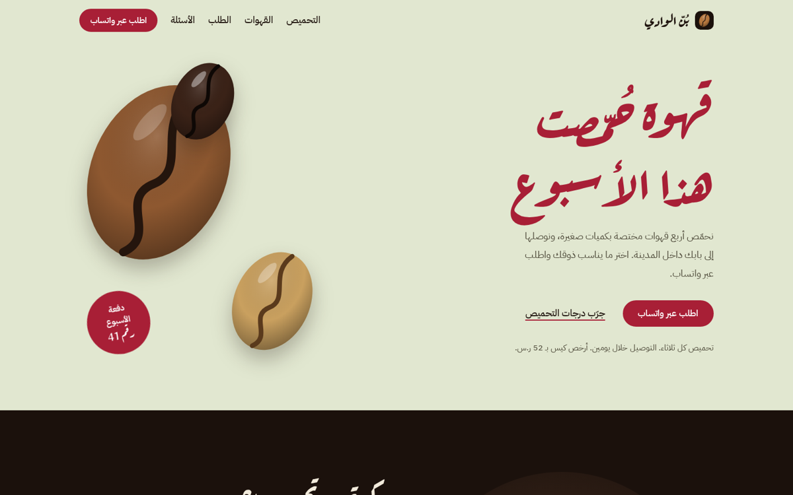
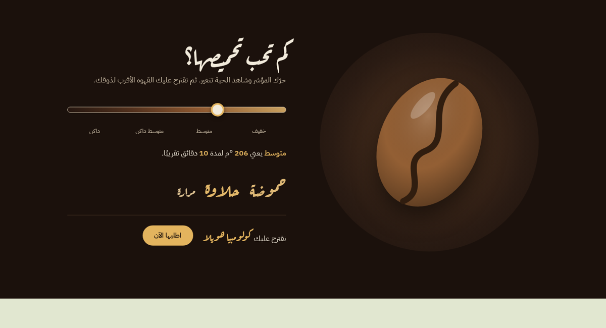
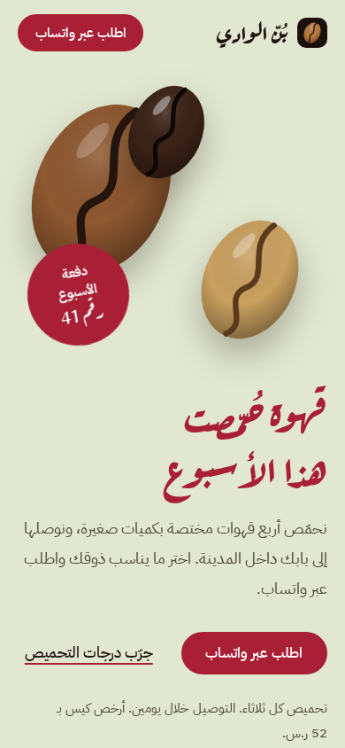

# بُنّ الوادي · Bunn Al-Wadi

**Arabic landing page for a specialty coffee roastery**

### 🔗 [Live site → abdullah-handal.github.io/roastery](https://abdullah-handal.github.io/roastery/)

## What it does

A fully Arabic (RTL) landing page that helps visitors pick a coffee and order it in one tap on WhatsApp.

- **Interactive roast selector**: drag the slider from light to dark and watch the bean change colour, the roast temperature and time update, and the tasting notes (acidity, sweetness, bitterness) grow or shrink. It then recommends the matching coffee and opens WhatsApp with the order message already written.
- **This week's coffees**: Ethiopia, Colombia, Yemen and Brazil with tasting notes, roast level and price per 250 g.
- **Ordering in four steps**, the roaster's story, and an FAQ about delivery, freshness and grinding.
- **Fast and light**: about 26 KB of code, no frameworks, no build step.

## Mobile first

Designed for phones first, down to 360 px wide, with large tap targets and a sticky WhatsApp order button.

## Built with

- HTML, CSS and vanilla JavaScript
- Hand-made SVG illustrations (bean, coffee terraces, favicon)
- Google Fonts: Aref Ruqaa for headings, IBM Plex Sans Arabic for text
- Accessibility: keyboard focus, reduced-motion support, AA colour contrast, semantic HTML
- Hosted on GitHub Pages

## Run locally

Open `index.html` in any browser. No install needed.

---

Designed and built by [Abdullah](https://github.com/Abdullah-Handal).
